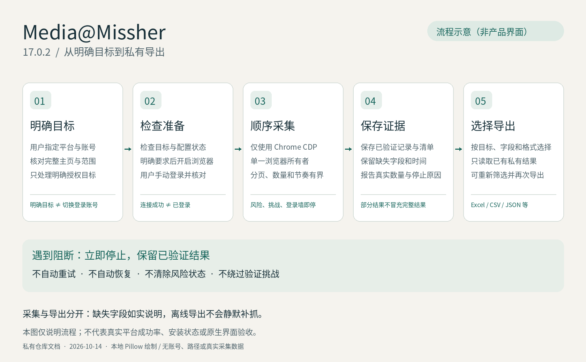

# Media@Missher 17.0.2

[← 桌面端与安装包](https://github.com/Missher12/Missher-DeepseekHarness-Desktop) · [全部插件](https://github.com/Missher12/Missher-DeepseekHarness-Desktop/blob/main/plugins/README.zh.md) · [通用安装指南](https://github.com/Missher12/Missher-DeepseekHarness-Desktop/blob/main/docs/cookbook/install-cordis-plugins.zh.md)

## 新手上手：Media@Missher（私有）

使用 Chrome CDP 采集支持的平台内容，保留私有证据，并按选择导出。

| 你需要知道的事 | 说明 |
| --- | --- |
| 插件包名 | `@missher/dsh-media-missher` |
| 当前源码版本 | `17.0.2` |
| 装好后在哪里使用 | 本仓库 QUICKSTART.md；DSH Bundle 入口见 harness-plugin/README.md |
| 下载 / 源码 | 当前下载见 [Releases](https://github.com/Missher12/Missher-Media/releases)；[查看源码与包信息](https://github.com/Missher12/Missher-Media)，按版本和校验值核对 |

### 安装、启用与第一次使用

1. 先从[桌面端主页](https://github.com/Missher12/Missher-DeepseekHarness-Desktop)下载适合电脑的应用，完成模型配置。这个仓库是可选插件，不是独立桌面应用。
2. 阅读[通用安装指南](https://github.com/Missher12/Missher-DeepseekHarness-Desktop/blob/main/docs/cookbook/install-cordis-plugins.zh.md)及本页原有安装说明，核对宿主与插件版本。桌面版使用“插件 → 添加插件”；Web/CLI 使用自己的目标配置组，不混用两种安装位置。
3. 安装后按宿主提示启用并重新加载，进入上表列出的入口。更新已有插件前保留配置和数据，不同时启用旧包名与新包名。
4. 按照快速开始配置 Chrome，先检查状态，再对自己明确指定的公开或已获授权目标进行小范围采集。

### 使用前了解这些边界

需要本仓库访问权限和 Chrome 环境。登录态、采集记录与私有配置不属于公共桌面下载内容。

如果页面或功能没出现，先检查当前应用版本、插件是否启用以及加载错误。反馈时附版本、复现步骤和已脱敏错误；不要上传 API Key、真实会话、账号 Cookie 或学习数据库。Git 中的代码更新不会自动替换电脑上已安装的插件。
本仓库保持私有；没有权限时 GitHub 会显示 404，请由仓库所有者授予访问权限。


### 继续阅读

下文保留本插件的详细行为、配置、开发和验证说明。跨平台是否实际通过，以对应版本的验证记录为准；桌面安装包能启动，不代表全部插件和外部服务都已验收。

---

DSH 当前包名：`@missher/dsh-media-missher`。2026-09-29 统一命名；仓库与源码目录、配置键及数据目录保持原有值。旧包升级需替换旧依赖与 Bundle 引用，不应同时启用新旧包。

为 Agent 提供媒体采集、私有证据保存和选择导出。**仅使用 Chrome CDP**，支持 Bilibili、小红书、抖音、微博和 X。通用 CLI、共享 Skill、DSH Bundle 共用同一采集核心。

运行时、Agent CLI 和 DSH Bundle 统一为 **17.0.2**。源码和分发保持私有；© 2026 Missher，原创软件采用[专有许可](LICENSE)，第三方依赖遵循[各自许可](THIRD_PARTY_NOTICES.md)。

## 从这里开始

| 目的 | 入口 |
| --- | --- |
| 看能抓什么、字段有哪些条件限制 | [数据能力与字段说明](DATA_CAPABILITIES.md) |
| 安装、导入博主、准备 Chrome、采集和导出 | [中文快速开始](QUICKSTART.md) |
| 让 Codex、Hermes 等 Agent 接入 | [Agent 安装指南](AGENT_INSTALL.md) |
| 给 DeepSeek Harness 接入 | [DSH Bundle 说明](harness-plugin/README.md)、[Agent 操作说明](harness-plugin/AGENT.md) |
| 看结果形态 | [JSON 示例](examples/posts.sample.json)、[CSV 示例](examples/posts.sample.csv)；全部为虚构数据 |
| 查看本版交付及验证边界 | [17.0.2 交付记录](docs/releases/v17.0.2.md) |
| 继续维护 | [项目摘要](PROJECT_CONTEXT.md)、[交接记录](HANDOVER.md) |

## 能力概览



图中不含真实采集数据；它说明使用流程，不代表实采或原生 UI 验收。[图片来源与复现方法](docs/images/README.md) · [官方 alpha.5 已验证范围（2026-10-17）](docs/HOST_COMPATIBILITY_2026-10-17.md) · [双社区 Host 历史核验（2026-10-14）](docs/HOST_COMPATIBILITY_2026-10-14.md)

作品字段包括标题/正文、作者、时间、原文链接、平台原生 ID 和可取得的互动数；各平台另有图片、视频链接或其他字段。小红书可按需请求评论明细和截图。微博普通话题分开保存帖子、观察到的发帖者关系与公开主页资料。详情见字段说明，不把缺失值写成零。

支持显式多目标，按顺序执行并精确绑定目标。先保存私有结果和运行清单；随后选择目标、记录类别、字段和格式，离线导出 Excel、CSV、JSON、JSONL 或 SQLite。

保持单一浏览器所有者；遇到风险、挑战、登录墙或身份歧义立即停止。小红书每批最多 10 条/3 页、两批开始间隔至少 600 秒。其他平台每批最多 20 条/3 页，正常开始间隔为 B 站/抖音 60 秒、微博 90 秒、X 120 秒；同一用户下跨任务保存，固定条数请求也受单批预算约束。Computer Use 与 BrowserSkill 已退役，旧请求明确拒绝，历史结果仍可读取和导出。

## 交付文件

产物位于 [`dist/v17.0.2/`](dist/v17.0.2/)，统一校验文件为 `SHA256SUMS.txt`：

- `Media-Missher-v17.0.2.zip`：完整交付包，含安装入口、DSH Bundle、源码、字段文档、示例和验证记录。
- `Media-Missher-Agent-Setup-v17.0.2.zip`：通用 Agent 安装包。
- `missher-media-missher-17.0.2.tgz`：通用 CLI 包。
- `missher-dsh-media-missher-17.0.2.tgz`：macOS DSH Bundle。
- `Media-Missher-Source-v17.0.2.zip`：源码与测试，解压后可重新构建。

首次安装依赖需要可用的包源；本包不是全部依赖离线镜像。打包和上传 Git 不会修改本机已安装的 Skill、运行时或 Harness profile。

DSH 按 Git 地址安装使用根目录 `package.json` 的组合包声明和 `git-bundle/` 冻结入口。17.0.2 本地候选与精确安装包保持一致；远端是否包含本版需核对发布回执。本地安装请选择上面的 DSH tgz。Git 安装问题的历史原因见 [修复记录](docs/GIT_INSTALL_2026-09-28.md)。

## 环境与验证

通用 CLI 要求 Node.js >=22.19、npm；采集运行时支持 Python 3.11/3.12。macOS/Linux 使用同一包，Windows 通过 WSL2/WSLg。浏览器、Agent 命令和私有文件须处于匹配环境。DSH Bundle 当前限定 macOS。模型和推理级别沿用宿主设置，本项目不包含模型 API 客户端。

准确验证结果见交付包 `VALIDATION.json`。离线测试、本地 Chrome CDP、隔离安装、真实宿主注册及真实平台采集分别记录。本次交付没有执行真实平台采集；合成数据和安装成功不代表实采验收。历史 DSH 0.6.1 兼容分支仍保留；当前 Bundle 沿用 17.0.1 已完成的宿主适配。

## 开发和打包

```sh
pnpm --dir harness-plugin install --frozen-lockfile
npm install --prefix agent-plugin --ignore-scripts --no-audit --no-fund --no-package-lock
node tools/build_distribution.mjs
node tools/verify_distribution.mjs dist/v17.0.2
```

完整测试命令位于 `.github/workflows/ci.yml`。`runtime/` 为 Python 核心，`media-missher/` 为共享 Skill 与入口，`agent-plugin/` 为通用 CLI，`harness-plugin/` 为 DSH 适配。交付排除浏览器目录、凭据、真实采集结果、依赖缓存和本机证据目录。

旧 15.6.0 候选的版本、安装和归档摘要见[历史基准](docs/CURRENT_BASELINE.md)。根目录旧 GitHub bootstrap 只对应 v15.2.1，不用于本版安装。
