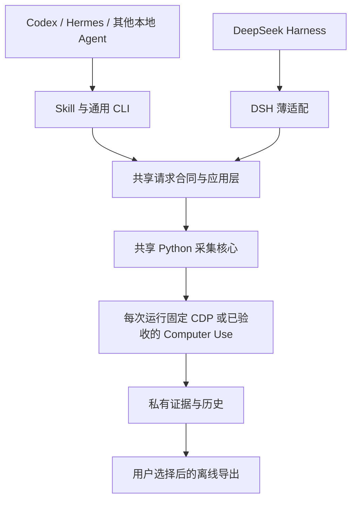

# Media@Missher V17 问题研究与开发顺序

后续范围更新：用户在本研究后决定先只保留 Chrome CDP 并精简代码。Computer Use 建设计划取消，其他升级与宿主建议暂不展开；当前实施与验证见 [CDP 精简记录](CDP_ONLY_2026-09-26.md)。以下保留研究时的证据与建议，不作为最新开发指令。

日期：2026-09-26。用户确定下一代直接使用 **V17，目标产品版本 17.0.0**。本文完成问题研究并定义下一代验收要求，尚未开始产品实现或发布。当前源码、安装态和冻结候选仍是 runtime 15.6.0 / Agent CLI 0.1.0 / DSH Bundle 0.6.0，详见[当前基准](CURRENT_BASELINE.md)。

建议把 V17 的目标定为：同一套 Media 核心在不同 Agent 中使用时，版本、安装归属、任务参数、停止行为和结果含义一致。优先修复接入与升级问题，保留现有采集能力；本轮没有发现足以支持推倒重写核心的证据。

## 研究结论

| 优先级 | 问题 | 证据层级 | V17 要求 |
| --- | --- | --- | --- |
| P1 | 旧入口遇到新版共享运行时，会请求安装自己携带的旧版 | 临时目录复现，安装前截停 | 新旧入口并存不能覆盖彼此的运行时 |
| P1 | Hermes 自动安装路径忽略 `HERMES_HOME` | 源码、官方说明、离线复现 | 明确目标 profile，安装位置与宿主发现位置一致 |
| P1 | 当前 DSH 入口仍使用独立进程执行器；环境过滤与卸载管理修复未合入 | 环境继承已复现；卸载风险为静态判断 | 合入适配修复并在目标宿主验证取消与卸载 |
| P2 | Python、通用 CLI 与 DSH 对外参数不一致 | 文档和参数解析复现 | 公共能力合同一致，差异明确可查询 |
| P2 | 产品版本多处硬编码，同号构建身份不足，通用构建依赖 Harness 工程 | 静态检查 | 单一发布清单、可核对的构建身份、宿主无关共享层 |
| 条件性发布门槛 | Computer Use 缺真实宿主桥接，核心只接受有限模式 | 离线拒绝行为和源码确认 | 若声明正式支持，须完成对应宿主与模式验收 |

P1 应在 V17 候选形成前解决；P2 随公共入口整合完成。Computer Use 可以先保留明确的实验状态，但不能作为“任意 Agent 可直接使用”的卖点。

## 1. 旧入口会请求用 15.6.0 替换 17.0.0

**问题：** 当前运行时选择器只接受与入口内嵌版本完全相同的运行时；发现不同版本就进入安装分支，没有区分较旧、较新或其他构建。

**原因：** [runtime.ts](../harness-plugin/src/runtime.ts) 的 `exactRuntimePython`（134–148 行）只比较 `current/VERSION` 与 `EMBEDDED_VERSION`；`ensureRuntime`（151–195 行）不匹配时调用随包安装器，传入同一个 `runtimeHome` 和 `--runtime-only`。[安装器](../tools/install_media_missher.py) 读取源版本并原子替换布局，但本轮检查未发现阻止旧包覆盖新版的版本比较。原子替换解决一致提交问题，并不自动解决版本倒退。

**影响：** 如果 V17 继续占用旧版共享 `current/venv`，残留的旧 CLI 或 Bundle 调用可能把它换回 15.6.0。`--runtime-only` 不同步其他 Skill，还可能令同一机器上的入口与运行时不再配套。本轮确认的是“请求降版安装”路径，未实际执行安装、未证明真实机器发生过降版。

**复现：** 临时目录放置标为 17.0.0 的模拟运行时，用真实 `ensureRuntime` 和标为 15.6.0 的模拟 payload 调用。注入的执行器收到 15.6.0 安装请求后立即截停；临时运行时仍为 17.0.0，真实安装态未被触碰。

**推荐方案：** V17 使用按构建身份隔离的运行时及配套 Python 环境，每个入口固定解析到对应构建；升级管理单独负责切换。新安装器拒绝隐式降版，回退必须是明确操作并保留恢复材料。仅给 V17 安装器增加判断还不够，因为旧包携带旧安装器；必须同时确保旧包无法通过原来的可变目录替换 V17 正在使用的文件。共享采集锁、风险暂停和身份约束继续跨版本生效，不能随运行时目录隔离而被重置或绕过。

**验收：** 15.6 与 17 两个入口交替运行、同版本不同构建、安装中断、显式回退分别验证；运行时字节、入口绑定、共享锁和风险状态均符合预期。

## 2. Hermes 可能安装到非当前 profile

**问题：** 自动选择 Hermes 时，安装器固定指向 `~/.hermes/skills`，忽略调用环境的 `HERMES_HOME`。

**原因：** [skills.mjs](../agent-plugin/src/skills.mjs) 的 `listAgents`（24–34 行）对 Codex 读取 `CODEX_HOME`，对 Hermes 仍使用固定路径。Hermes 文档说明 profile 有各自的 `HERMES_HOME`；本机 `hermes_constants.py` 的 `get_hermes_home` 与 `tools/skills_tool.py` 的技能目录解析也采用宿主目录。[Hermes 官方 Skills 说明](https://hermes-agent.nousresearch.com/docs/user-guide/features/skills/)

**影响：** 使用自定义 profile 时，安装可以完成，但当前 Hermes 可能看不到新 Skill。`--skill-root` 可以显式指定目录，现有自动选址仍需修复。本机还存在 `openclaw-custom/media-missher` 下的旧 15.2.0 Skill，安装新副本后需要核对实际选中的 Skill；本轮没有证实发生了同名覆盖或当前会话冲突。

**复现：** 给 `listAgents` 传入模拟 home 与 `HERMES_HOME=/tmp/media-v17-synthetic-home/profiles/research`；返回的目录仍是默认 `.hermes/skills`，没有跟随自定义路径。测试没有写入 Hermes 目录。

**推荐方案：** 目标目录优先使用显式 `--skill-root`，其次使用所选宿主/profile 的目录，最后才采用默认值。安装结果显示目标 profile、Skill 实际路径、版本和安装归属；发现同名旧入口时先记录来源并给出明确迁移路径，不能静默删除。Codex 原子安装器管理的同名 Skill 继续保持独立归属。

**验收：** 默认 Hermes、自定义 `HERMES_HOME`、显式路径和旧同名 Skill 共存分别验证；在目标 profile 的新会话里确认发现路径，再执行离线命令，不能只检查文件存在。

## 3. DSH 的进程适配修复还在另一条开发线

**问题：** 当前主开发版没有合入独立 Bundle 0.6.1 的宿主进程管理修复。

**原因：** [当前 process.ts](../harness-plugin/src/process.ts) 的 `runProcess`（106–131 行）直接启动子进程，并把传入环境叠加到完整 `process.env`；[当前 index.ts](../harness-plugin/src/index.ts) 的 `apply`（394–404 行）没有接入 `ctx.subprocess` 与对应在途任务卸载处理。只读兼容分支的 `host-process.ts` 和 `index.ts` 已有宿主执行器、取消与卸载衔接，具体来源见[两条开发线比较](CURRENT_BASELINE.md)。

**影响：** Media 子进程可以继承不需要的宿主环境；插件卸载后的在途任务回收也需要验证。当前执行器已有超时、调用方取消、输出限制和进程组终止，不能将问题描述为“完全没有取消保护”。本轮未使用真实凭据，也未复现实际密钥泄露或宿主卸载后遗留进程。

**复现：** 在独立测试进程中添加无敏感内容的环境标记，调用 `runProcess(..., { env: {} })`；子进程仍能检测到标记。输出仅记录布尔值，没有读取或打印实际秘密。

**推荐方案：** 从兼容分支逐项提取宿主执行器与生命周期修复，保留当前 X、多目标、恢复和导出实现。DSH 使用宿主管理的进程范围；通用 CLI 保留独立执行器，但采用明确的环境传递规则和可测试的取消合同。环境收敛须保留实际需要的路径、语言、代理与浏览器设置，不宜简单清空全部环境。

**验收：** 当前目标 DSH 中覆盖正常退出、超时、用户取消、在途卸载和子孙进程回收；用合成敏感变量确认不会越界继承。兼容分支旧宿主的历史通过记录不能替代本次组合验收。

## 4. “同一核心”还没有成为一致的公共入口

**问题：** Python Skill wrapper 可以表达截图与部分完整性设置，通用 CLI 和 DSH 公共工具没有暴露同一组选项。

**原因：** [入口参数说明](ENTRY_PARAMETER_PARITY.md) 已明确这些差异；各入口有自己的参数解析与映射。本轮确认 `collect --screenshot-mode opened` 被通用 CLI 拒绝，DSH 的 `screenshot_mode` 也被归一化器拒绝。

**影响：** 用户换一个 Agent 后，可表达的采集请求可能改变。这是当前已声明的能力差异，不应误报成“现有参数坏了”。但若 V17 承诺统一使用体验，就需要统一公共合同或清楚报告不支持的组合。

**推荐方案：** 以版本化计划为公共请求合同，统一显式值与默认值合并、目标校验、权限、恢复身份、停止原因和导出规则。各入口只做字段翻译；能力查询列出平台、后端、目标模式、截图/评论等组合及拒绝原因。能力字段至少区分“代码支持”“本机配置”“本会话可用”“真实平台已验收”，不能用单个 `supported` 代替全部状态。

**验收：** 同一测试计划经过 Python、CLI、DSH 后得到等价的冻结计划与结果状态；显式 `0/off/false` 不能被默认值覆盖，不支持的组合必须在创建任务或浏览器操作前拒绝。保留现有的导航授权与条数限制。

## 5. 版本与构建需要有一个权威来源

**问题：** 当前产品版本散落在根 `VERSION`、Python adapter、Harness runtime、Agent CLI 与归档脚本中；同为 15.6.0 的不同开发线包含不同实现。运行时复用检查只按版本文字判断，不能证明构建一致。

**原因：** [Agent 构建脚本](../agent-plugin/scripts/build.mjs)（10–18 行）先构建 Harness，再复制其 `lib/index.js` 与 payload。通用 CLI 运行时不要求 DSH，但构建层的共享实现仍寄存在 Harness 工程。多处手工维护版本和跨目录复制会扩大发布核对范围。

**影响：** 只修改 `VERSION` 无法形成可靠的 V17；文档、CLI、安装器和归档可能对“当前版本”给出不同答案。同号异构已经存在；本轮没有证明它已造成某次实际执行错误。

**推荐方案：** 以一份发布清单绑定产品版本 `17.0.0`、源码身份、构建摘要、组件版本和所需协议版本，构建时生成入口常量并校验 payload。CLI 与 Bundle 保留各自语义化组件版本，由清单明确组合，用户看到的产品代际统一为 V17。只有协议实际变化时才提升其版本，避免把产品代际与全部 schema 强行绑定。将通用配置、计划映射、运行时选择和调用合同放入宿主无关共享层，DSH 与 CLI 引用它；先收敛当前复制关系，不为目录整齐而重写采集器。

**验收：** 从同一确定源码生成各包，解包核对清单与字节，运行全新进程的版本/能力/离线调用。目录中留存归档或旧 `AGENT-ENTRY-EVIDENCE.json` 不代表它就是最新构建，旧证据按日期保留。

## 6. Computer Use 仍属于未完成能力

**问题：** 当前公开入口缺少真实宿主桥接，不能直接用宿主自带的电脑操作工具完成 Media 采集。

**原因（研究时）：** DSH 注册 `createComputerUseTool()`、Agent CLI 调用 `computerUseCommand` 时没有提供宿主 adapter；当时的 `runtime/media_missher_runtime/computer_use.py` 中 `prepare`（97–112 行）还明确拒绝多目标、非 X 平台和纯视觉观察。该模块之后已按用户决定删除，原文保存在本轮精简前的源码快照中。

**影响：** 离线能力查询正确返回 `ready: false / host-computer-use-unavailable`；实际 prepare 也拒绝。这是已有保护正确生效，不能通过改成 `ready: true` 解决。

**推荐方案：** V17 保留 CDP 独立默认与后端冻结。Computer Use 按实际宿主逐个实现身份、权限、观察证据、动作回执、取消和输出验证，先验收已有单目标结构化路径，再扩展平台和模式。跨 Agent 的 Skill 格式只提供指令与资源约定，脚本执行和工具权限支持仍与宿主有关；因此不能从“Skill 可读取”推断“电脑操作已接通”。这是结合规范与当前实现的工程判断。[Agent Skills 规范](https://agentskills.io/specification)

**验收：** 每个声明支持的宿主/模式都有独立真实桥接证据；未支持组合在开始前清楚拒绝，不静默改为 CDP，不用旧平台验收替代新模式。

## V17 的建议结构

以下为目标结构，尚未实现：

宿主负责模型、推理设置和其原生权限；Media 负责目标、顺序、计划、风险状态与证据。Agent、执行器、浏览器和文件必须处于可明确绑定的执行环境。当前没有证据支持承诺所有远程或云端 Agent 开箱即用，不能仅增加 Skill 目录就扩大这一范围。

## 实施顺序与完成标准

| 阶段 | 交付内容 | 完成标准 |
| --- | --- | --- |
| M0：升级与版本身份 | 发布清单、构建绑定、版本隔离与迁移设计 | 旧入口不能改写 V17；回退可控；私有 profile、历史、共享锁和风险暂停保留 |
| M1：共享合同与 DSH 适配 | 收敛应用层、选择性整合 0.6.1 进程修复 | 现有 X、多目标、恢复、导出不丢失；独立 CLI 和 DSH 生命周期分别通过 |
| M2：宿主安装与发现 | Hermes profile 支持、Skill 归属与同名迁移 | Codex/Hermes/DSH 分别确认实际路径、当前构建、新会话发现及离线调用 |
| M3：能力一致性 | 参数映射、模式矩阵、CU 可用性报告 | 同一请求语义一致；CU 未交付部分明确标记，交付部分完成真实桥接验证 |
| M4：V17 候选与验收 | 一组绑定清单的私有包与验证记录 | 包校验、干净安装、原生宿主调用、授权范围内真实采集逐层记录；没有用离线结果代替线上结论 |

第一项实施任务应是 M0。直接将现有常量替换成 17.0.0 并打包，会把最重要的旧入口兼容问题带入新版。

## 本轮研究证据与边界

| 检查 | 本轮结果 | 能证明什么 |
| --- | --- | --- |
| 6 组隔离探针 | 完成，详见本地研究证据 | 两条安装选择问题、环境继承、两个参数拒绝和 CU 无宿主拒绝 |
| Harness runtime/process/computer-use 既有测试 | 3 个文件，26 项通过 | 所覆盖的现有离线合同成立 |
| Python backend retirement/computer-use/batch recovery/shared safety 既有测试 | 44 项通过 | 退役、CU 拒绝、恢复与共享保护的所测行为成立 |
| 既有文档回归 | 7 项通过，17 项未选中 | 入口摘要与既有文档约束一致 |
| 文档、差异与归档保护检查 | 核对 389 个既有文件、49 个本地链接、3 份冻结归档 | 仅更新所列文档与总入口，产品实现和归档字节保持不变 |
| 当前 DSH/Hermes 原生组合、各平台真实采集 | 未执行 | 不能据本轮研究声称已经通过 |

本地证据目录：`.superpowers/sdd/2026-09-26-v17-research/`，包含 `before.json`、`before-docs/`、`probes.mjs`、`probes.json`、`focused-checks.json`，完成检查后附 `verification.json`。复现仅使用合成标记与临时布局；真实安装次数、浏览器启动次数、平台请求次数均为 0。70 项现有离线测试通过不代表新发现的问题已经修复；它们还需要在实施时加入有针对性的回归覆盖。

本轮完成下一代命名、问题研究和项目入口更新。源码版本、现有安装、历史分支和冻结归档保持原状；本文是后续 V17 实施依据，不是 V17 发布说明。
